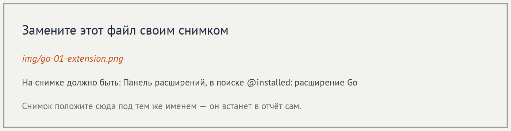
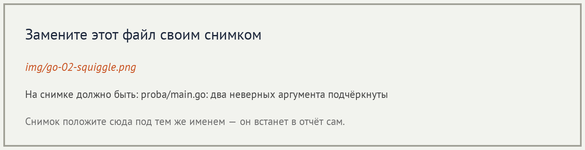
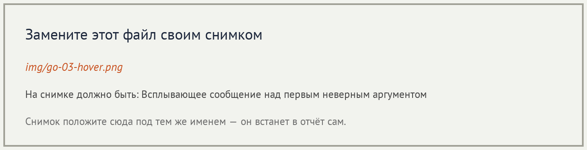
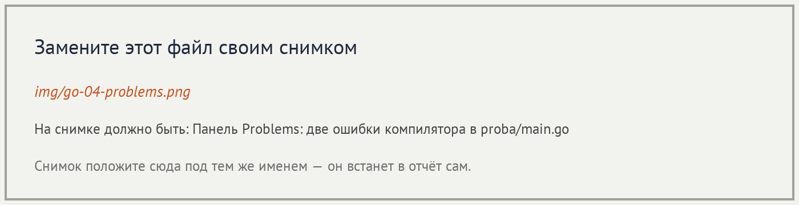
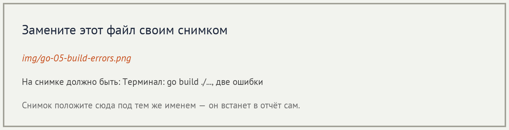
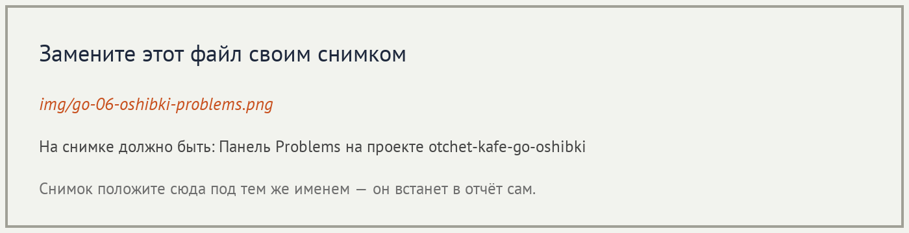
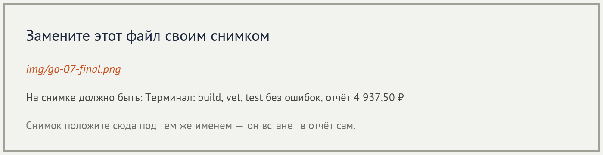

# Отчёт · Проверка типов: gopls, go build и go vet

**Студент:** Селезнев Александр, группа РПО25/1

## 1. Подготовка



## 2. Проверка в редакторе

```go
package main

import "example.com/otchet-kafe/internal/utils"

func main() {
	title := utils.FormatTitle(40, 40)
	price := utils.FormatKopeks("1250")
	_, _ = title, price
}
```





Разбор сообщения:

| Часть сообщения | Что означает |
|---|---|
| `cannot use 40` | Число 40 нельзя подставить в этот аргумент. |
| `(untyped int constant)` | Это целая константа из текста программы, у неё ещё нет окончательного типа. |
| `as string value in argument to utils.FormatTitle` | Первый аргумент `FormatTitle` должен быть строкой. Число в строку само не превращается. |



## 3. Проверка в терминале

```text
# example.com/otchet-kafe/proba
proba\main.go:6:29: cannot use 40 (untyped int constant) as string value in argument to utils.FormatTitle
proba\main.go:7:30: cannot use "1250" (untyped string constant) as int value in argument to utils.FormatKopeks
```



```text
go build ./...
go vet ./...
```

Обе команды после исправления вызовов завершились без сообщений.

## 4. Проект с ошибками типов



| Этап | Ошибок в `go build ./...` | Ошибок в Problems |
|---|---|---|
| исходно | 3 | 12 |
| после `internal/utils` | 2 | 9 |
| после `internal/domain` | 6 | 7 |
| после `internal/services` | 1 | 1 |
| после `main.go` | 0 | 0 |

После `internal/domain` число в терминале выросло с 2 до 6. Пока `domain` не собирался, компилятор не проверял `services`: пакету не на что опереться. gopls при этом уже показывал все 12 ошибок. Когда `domain` собрался, в терминале впервые появились шесть ошибок `services`.

Пакет до и после — `internal/utils`:

```go
return strings.Join(groups, " ") + "," + cents + " ₽"
return strings.Join(strings.Fields(value))
runes[0] = unicode.ToUpper(word[0])
```

```go
return strings.Join(groups, " ") + "," + strconv.Itoa(cents/10) + strconv.Itoa(cents%10) + " ₽"
return strings.Join(strings.Fields(value), " ")
runes[0] = unicode.ToUpper(runes[0])
```

```text
go build ./...
go vet ./...

?   	example.com/otchet-kafe	[no test files]
ok  	example.com/otchet-kafe/internal/domain	0.574s
ok  	example.com/otchet-kafe/internal/services	0.587s
?   	example.com/otchet-kafe/internal/ui	[no test files]
ok  	example.com/otchet-kafe/internal/utils	0.559s

=========== Смена 09.11.2026 ===========
Петрова Анна                  2 480,50 ₽
Иванов Пётр                   1 685,00 ₽
Сидоров Илья                    772,00 ₽
=========== Итого 4 937,50 ₽ ===========
```



## 5. Выводы

gopls и `go build` ищут одни и те же ошибки типов и пишут почти одинаковый текст. Разница в том, сколько видно сразу: панель Problems показывает ошибки всех пакетов, а `go build ./...` останавливается на первом пакете, который не собрался. `go vet` запускается уже после успешной сборки и ищет подозрительный, но собирающийся код, например неверный формат `Printf`. Неожиданным было то, что после исправления `domain` сообщений в терминале стало больше, а не меньше: открылись ошибки `services`, которые раньше были скрыты. Компилятор не запускает программу и не проверяет сумму отчёта: итог `4 937,50 ₽` подтвердили отдельные команды `go test ./...` и `go run .`.
