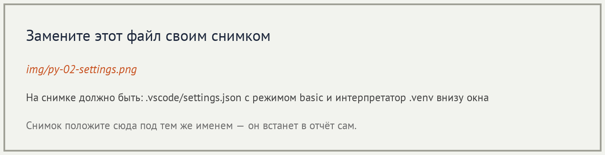
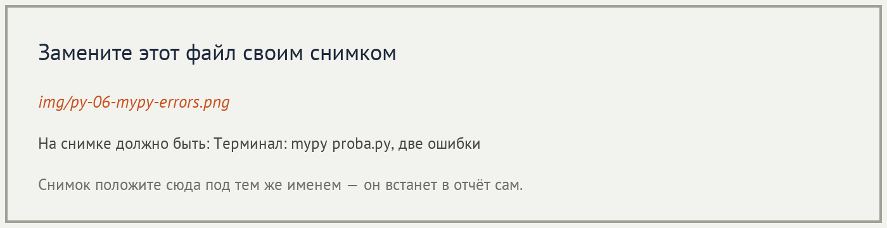
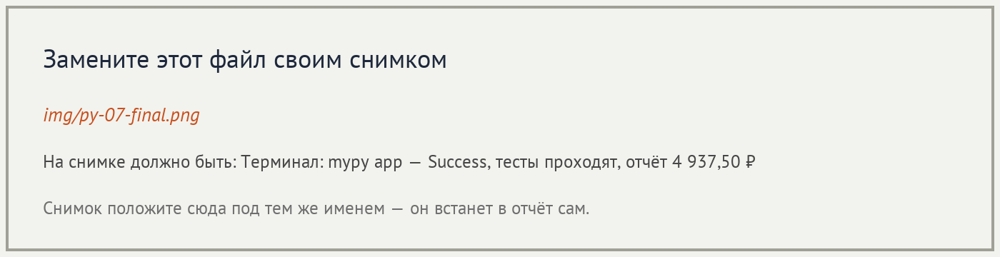

# Отчёт · Проверка типов: Pylance и mypy

**Студент:** Селезнев Александр, группа РПО25/1

## 1. Подготовка




## 2. Проверка в редакторе

```python
from app.utils.formatter import format_kopeks, format_title

title = format_title(40)
price = format_kopeks("1250")
```


Разбор сообщения:

| Часть сообщения | Что означает |
|---|---|
| `Argument of type "Literal[40]"` | В первый аргумент передано конкретное число 40. `Literal[40]` — частный случай `int`. |
| `cannot be assigned to parameter "text" of type "str"` | Параметр `text` функции `format_title` ждёт строку, число туда не подходит. |
| `Pylance(reportArgumentType)` | Сообщение написал Pylance по правилу о неверном типе аргумента. |


## 3. Проверка в терминале

```text
proba.py:3: error: Argument 1 to "format_title" has incompatible type "int"; expected "str"  [arg-type]
proba.py:4: error: Argument 1 to "format_kopeks" has incompatible type "str"; expected "int"  [arg-type]
Found 2 errors in 1 file (checked 1 source file)
```



```text
Success: no issues found in 1 source file
```

## 4. Проект без аннотаций

| Этап | Итог `mypy app` |
|---|---|
| исходно | `Found 17 errors in 10 files (checked 15 source files)` |
| после `utils` | `Found 12 errors in 7 files (checked 15 source files)` |
| после `domain` | `Found 8 errors in 5 files (checked 15 source files)` |
| после `services` | `Found 1 error in 1 file (checked 15 source files)` |
| после `ui` | `Success: no issues found in 15 source files` |

Модуль до и после — `app/utils/formatter.py`:

```python
def format_kopeks(kopeks):
    ...

def format_title(text, width=40):
    ...
```

```python
def format_kopeks(kopeks: int) -> str:
    ...

def format_title(text: str, width: int = 40) -> str:
    ...
```

```text
Success: no issues found in 15 source files

............                                                             [100%]
12 passed in 0.08s

=========== Смена 09.11.2026 ===========
Петрова Анна                  2 480,50 ₽
Иванов Пётр                   1 685,00 ₽
Сидоров Илья                    772,00 ₽
=========== Итого 4 937,50 ₽ ===========
```



## 5. Выводы

Pylance подчёркивает неверный аргумент прямо в редакторе, а mypy печатает ту же ошибку в терминале: файл, строка и какой тип пришёл вместо ожидаемого. В `proba.py` оба инструмента нашли одни и те же два вызова, только назвали их по-разному: Pylance пишет `Literal[40]` и `reportArgumentType`, mypy пишет `int` и `arg-type`. Неожиданным было то, что проект совсем без аннотаций mypy не считает правильным: при `disallow_untyped_defs` он выдал 17 ошибок `no-untyped-def`, хотя программа при этом запускается. После подписей пакетов по порядку `utils`, `domain`, `services`, `ui` ошибок не осталось. Проверка типов не запускает код и не ловит неверную сумму или пустой файл, если типы при этом сходятся: это видно по отдельным командам `pytest` и `python main.py`, которые дали 12 тестов и итог `4 937,50 ₽`.
